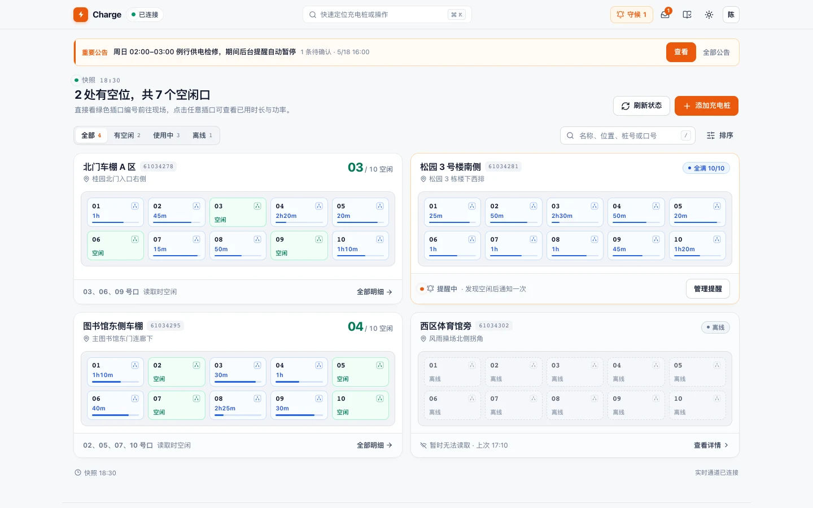
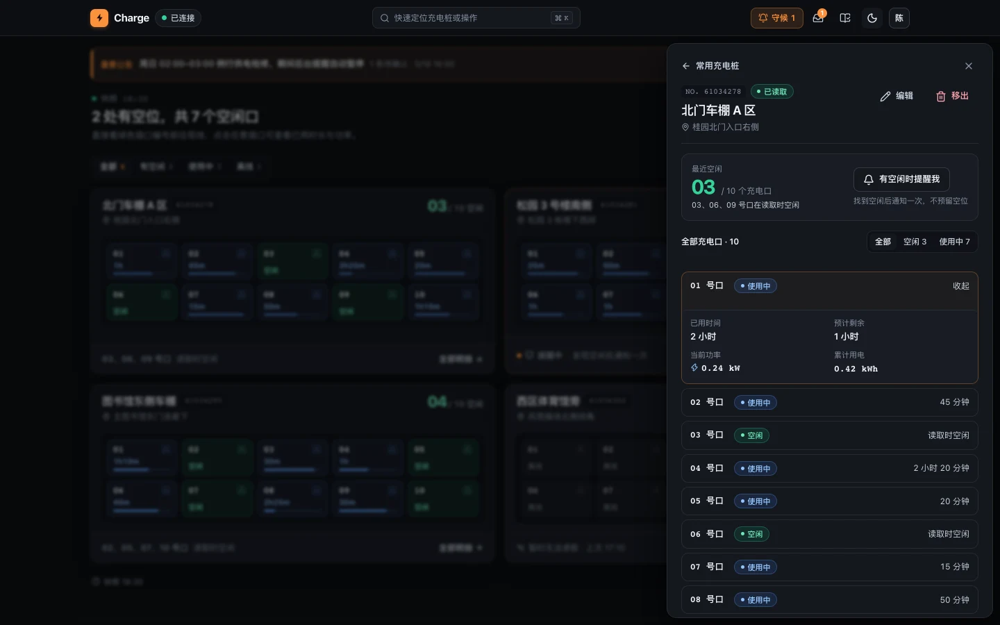
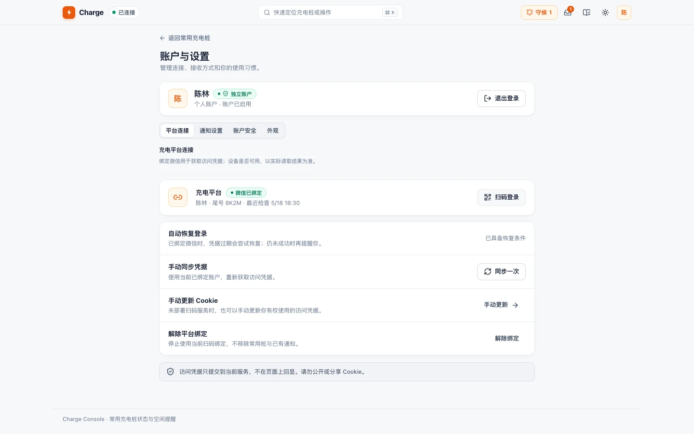
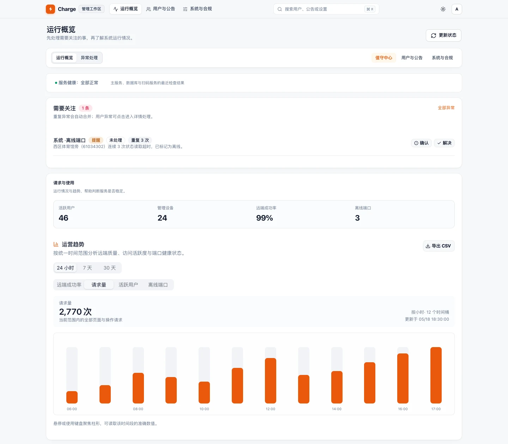
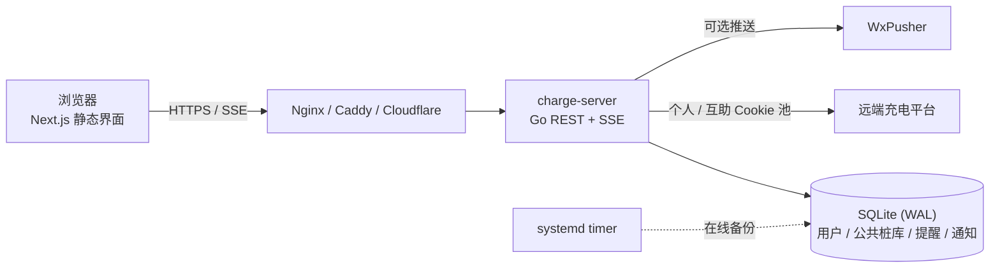

<div align="center">

# Charge Console

**下楼之前，先看清哪儿有空口。**

轻量、自托管的充电桩实时看板与空闲提醒系统，将常去的充电车棚固定在一张清晰画布中。

<p>
  <a href="https://github.com/ninuan/charge-api/actions/workflows/ci.yml"></a>
  <a href="https://github.com/ninuan/charge-api/releases"></a>
  
  
  
  <a href="LICENSE"></a>
</p>

<p>
  <a href="#为什么做-charge-console">特性</a> ·
  <a href="#界面预览">界面预览</a> ·
  <a href="#快速开始">快速开始</a> ·
  <a href="#架构与安全">架构与安全</a> ·
  <a href="#生产部署">生产部署</a> ·
  <a href="docs/openapi/charge-console-v1.5.5.yaml">OpenAPI</a> ·
  <a href="CHANGELOG.md">更新日志</a>
</p>

<br />



</div>

---

## 为什么做 Charge Console

每次充电前反复点开公众号或扫码确认车棚有没有空位，既繁琐又容易扑空。**Charge Console** 面向个人与小范围自托管场景，将常看的充电桩集中到同一工作台：

- **一眼看清物理插口状态**：双列硬件模块卡片直观区分空闲（绿）、使用中（蓝，附平台预计剩余与进度）和离线（虚线灰）；点击任意插口即可在右侧悬浮检查器查看已用时长、实时功率与累计用电。
- **公共桩库与互助 Cookie 池**：免抓包直接从全站共享桩库一键添加常用充电桩，录入新桩还可获得永久刷新次数奖励；普通账户默认享有每日与奖励刷新额度，上传个人 Cookie 并加入互助公共池后即可不限次刷新并解锁实时空闲守候（按 `wxopenid` 自动去重）。
- **刚好一次的空闲守候**：满位时一键开启 1 / 2 / 4 小时或持续至计划断电前的临时提醒，发现空口通知一次即自动停止；支持站内通知、浏览器弹窗、可选 WxPusher 微信推送与免打扰时段。
- **克制的远端访问保护**：仅在用户主动刷新或存在活动守候时请求远端，内置短时缓存、同桩请求合并、并发限制、单桩每日额度、失败退避与夜间计划断电窗口。
- **多用户隔离与管理工作台**：每位用户的设备、加密凭据、提醒和通知完全隔离；管理员可在内置工作区处理运行异常、管理公共 Cookie 池与公共桩库、调整用户永久刷新额度、发布公告并跟踪确认回执、管理邀请码及查看运营趋势与操作审计。
- **轻量快速的现代体验**：浅色 / 深色双主题、`⌘K` 快速定位、全视口流式响应式布局、按路由按需懒加载与「减少动态效果」无障碍支持。

> [!NOTE]
> 请仅接入你有权访问的设备，并遵守远端服务的使用规则。Charge Console 为非官方自托管看板工具，不用于高频采集。

### 界面预览

| 深色模式 · 悬浮插口检查器 | 账户与充电平台连接 | 管理工作区 · 异常与趋势 |
| :---: | :---: | :---: |
|  |  |  |

---

## 快速开始

### 环境要求

`Go 1.25+` · `Node.js 22+` · `pnpm 11+` · `Git` · `Make`

### 三步启动本地开发环境

```bash
git clone https://github.com/ninuan/charge-api.git
cd charge-api
make setup
make dev
```

启动完成后访问 `http://127.0.0.1:3000`：

| 项目       | 本地默认值                |
| ---------- | ------------------------- |
| 前端地址   | `http://127.0.0.1:3000`   |
| 管理员账号 | `admin` / `localadmin123` |
| 本地数据库 | `.local/charge_state.db`  |

> [!WARNING]
> 默认密码仅限本机开发使用。所有本地数据均位于已被 Git 忽略的 `.local/` 目录，按 `Ctrl+C` 即可同时停止前后端。

<details>
<summary><b>更多本地开发选项（自定义端口、重置数据、WxPusher 本地调试）</b></summary>

#### 覆盖默认配置

```bash
LOCAL_ADMIN_PASSWORD="your-password" make dev
BACKEND_PORT=18080 FRONTEND_PORT=5174 make dev
LOCAL_DATABASE_FILE=/private/tmp/charge-test.db make dev
```

#### 清空本地测试数据

```bash
make reset-local
```

#### 配置本地可选环境变量（如 WxPusher 调试）

```bash
mkdir -p .local
cp examples/dev.env.example .local/dev.env
```

按需取消 `.local/dev.env` 中 `WXPUSHER_APP_TOKEN`、`PUBLIC_BASE_URL` 等变量的注释后重新执行 `make dev`。

</details>

---

## 架构与安全

单二进制 Go 服务搭配静态导出的 Next.js 前端与嵌入式 SQLite，无需额外数据库、扫码 sidecar 或消息中间件即可完成部署。



- **凭据不出服务端**：浏览器仅与 Charge 通信，永不接触明文远端 Cookie 或 WxPusher AppToken。
- **静态加密与账户安全**：个人与互助池 Cookie、WxPusher UID 等敏感数据使用 `CHARGE_COOKIE_KEY` 通过 AES-256-GCM 加密落盘；密码采用 Argon2id，登录/注册配一次性图形验证码、IP 限流与失败锁定，会话撤销采用持久化优先 + 代次防护杜绝缓存复活。
- **可靠存储与严格内容安全**：SQLite 启用 WAL 读写分离与按用户/实体细粒度持久化；静态页面输出弱 `ETag`、`404.html` 回落及基于内联脚本 SHA-256 哈希的严格 CSP（兼容 Cloudflare Web Analytics）。
- **数据边界清晰**：站内通知为主记录，外部推送异常不阻断状态刷新；仅记录活动提醒与状态快照，不虚构或推算充电历史。

---

## 生产部署

推荐单台 Linux 服务器部署：反向代理终止 HTTPS，`charge-server` 仅监听 `127.0.0.1:8080`，由 `systemd` 托管服务与每日 SQLite 在线备份。

### 核心环境变量

| 变量                                     | 适用场景     | 说明                                                                   |
| ---------------------------------------- | ------------ | ---------------------------------------------------------------------- |
| `CHARGE_COOKIE_KEY`                      | 生产必需     | 32 字节 Base64 密钥，用于加密敏感凭据（生成后须妥善保存，不可随意更换） |
| `CHARGE_ADMIN_PASSWORD`                  | 首次初始化   | 初始化 `admin` 账号密码；已有数据库不会覆盖                            |
| `CORS_ALLOWED_ORIGINS`                   | 跨域部署可选 | 允许的 HTTPS 来源白名单，同源部署留空                                  |
| `WXPUSHER_APP_TOKEN` / `PUBLIC_BASE_URL` | 微信提醒可选 | WxPusher 服务端 AppToken 与对外 HTTPS Origin（不含路径与尾斜杠）       |

```bash
# 生成生产加密密钥（复制 CHARGE_COOKIE_KEY 到 /etc/charge-api.env）
./scripts/gen_secrets.sh

# 已完成首次部署后的日常发布（校验 → 推送 → 远端构建 → 原子替换前端与二进制 → 健康检查与失败自动回滚）
make deploy-git DEPLOY_HOST=root@your-server
```

完整的首次安装、systemd 单元、反向代理、安全巡检与在线备份恢复指南见 **[生产部署与运维指南](docs/deployment.md)**。

---

## 项目结构与开发验证

```text
backend/
  cmd/server/            Go 服务入口与静态资源托管
  internal/api/          REST / SSE 接口、限流与安全中间件
  internal/auth/         Argon2id 认证、会话管理与登录防爆破
  internal/runtime/      状态快照、公共池/桩库、空闲守候调度与通知投递
  internal/persistence/  SQLite 迁移、WAL 读写分离与加密存储
  internal/charger/      远端充电接口客户端

frontend/
  app/                   Next.js 路由（看板 / 提醒 / 通知 / 账户 / 管理 / 认证）
  components/            工作台、管理端与基础交互组件
  lib/                   API 客户端、SSE/通知上下文与领域逻辑
  e2e/                   Playwright 端到端测试

docs/openapi/            版本化 OpenAPI 契约（当前 v1.5.5）
deploy/systemd/          服务与 SQLite 在线备份模板
scripts/                 开发、校验、安全检查与原子发布脚本
```

### 运行完整测试门禁

```bash
# OpenAPI 类型漂移、脚本测试、ESLint、Go 测试构建、前端单测、类型检查与静态构建
make check

# Playwright 浏览器端到端测试
pnpm --dir frontend exec playwright install chromium
pnpm --dir frontend test:e2e
```

---

## 相关文档

- [生产部署与运维指南](docs/deployment.md)
- [OpenAPI v1.5.5 契约](docs/openapi/charge-console-v1.5.5.yaml)
- [更新日志](CHANGELOG.md) · [发布说明](RELEASE_NOTES.md)
- [本地环境变量模板](examples/dev.env.example)

## License

[MIT](LICENSE)
